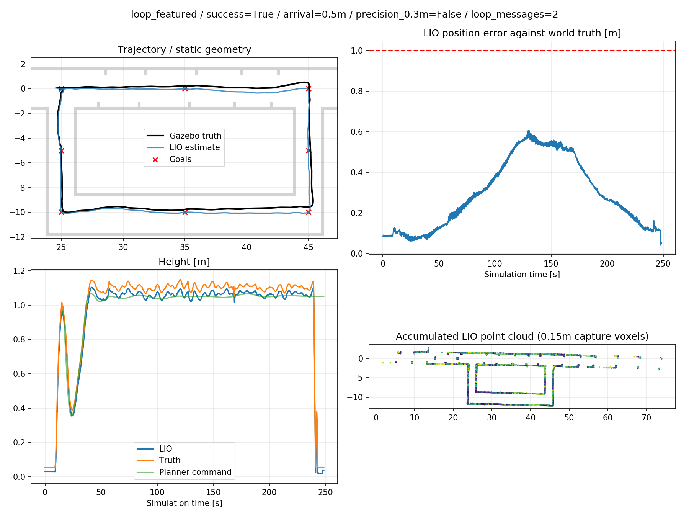
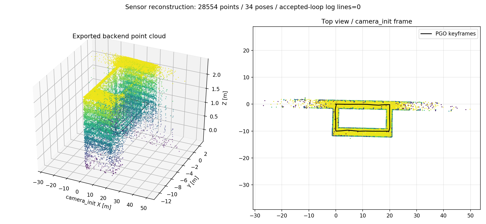
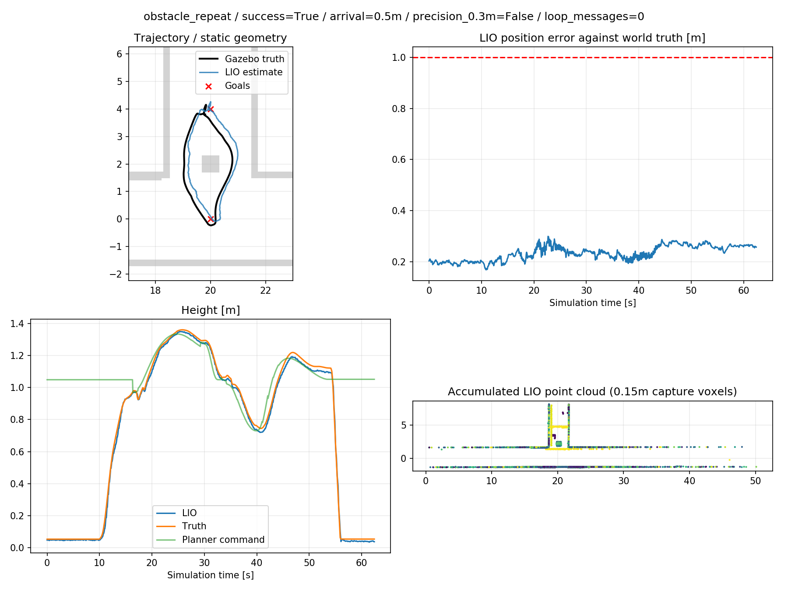
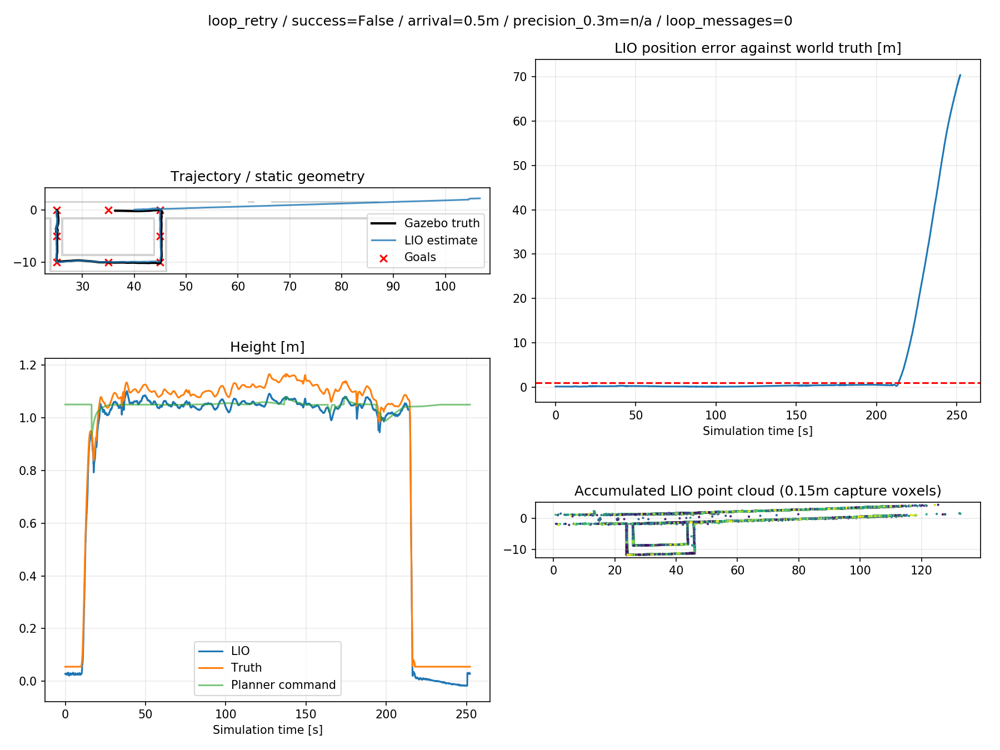
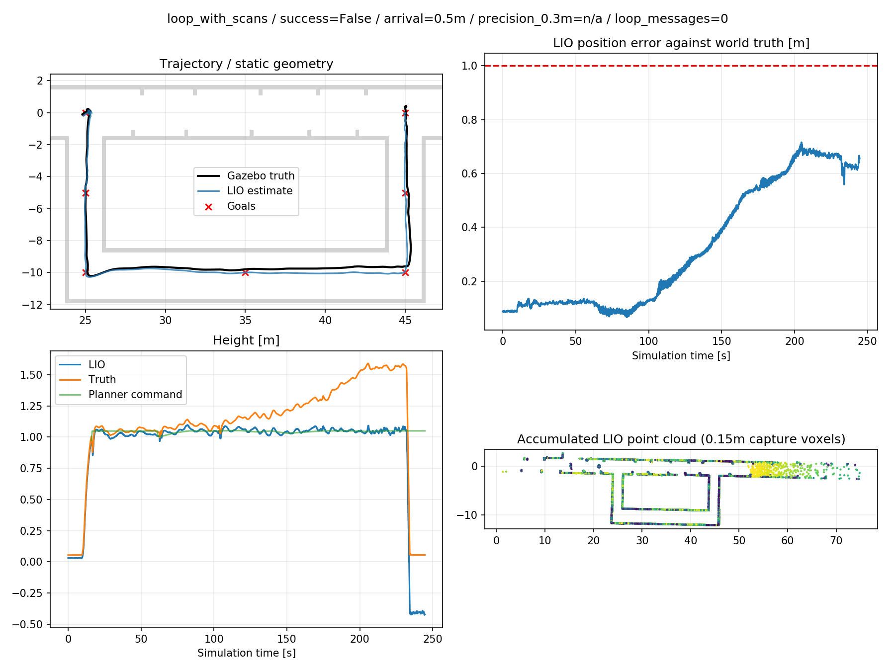
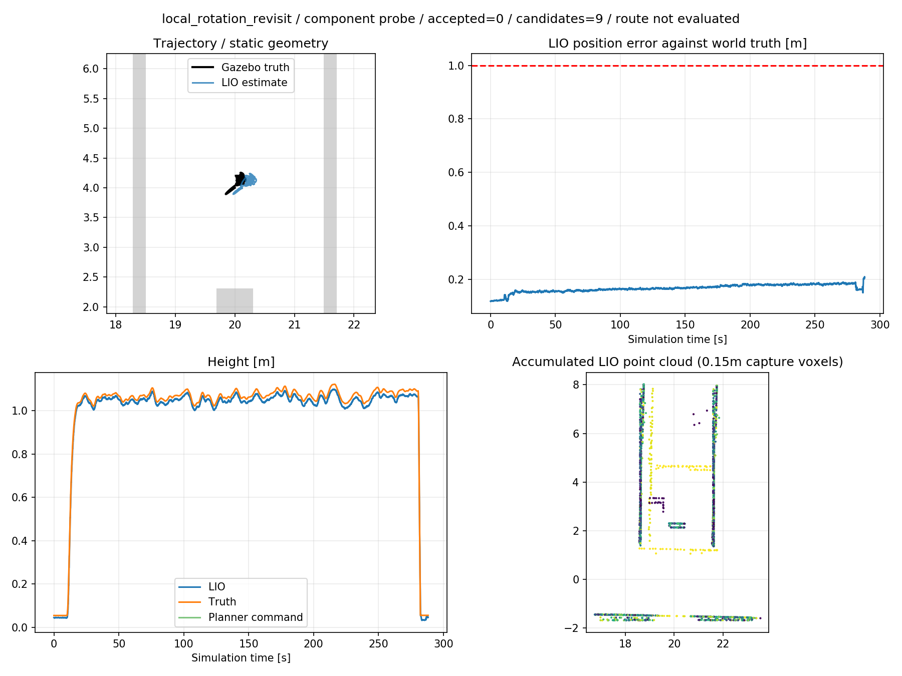

# 2026-10-22 实验结果

本目录为精选实验结果。所有图像与PCD来自真实SITL传感器与运行数据，不是仿真世界模型截图。

**真实回环尚未通过：本轮后端已接受回环约束数为0。后端输出路径或地图不代表回环纠漂成功。**

|项目|结果|
|---|---|
|高度约束绕障|两次往返通过，最低真实路线高度约0.711m、0.745m|
|特征增强隧道|9航点、累计约63.71m；0.5m到达门槛通过，0.3m精度未通过|
|原始隧道|定位发散后中止并降落；未完成闭合|
|增加扫描的路线|真实到达误差不满足门槛，中止并降落|
|定点真实复访|6圈、42子图、9组候选，0条接受|

## 飞行与地图

## 失败记录

[前端累计点云](tunnel_frontend_map.pcd) · [后端点云（无已接受回环）](tunnel_backend_without_accepted_loop.pcd)

完整解释见[执行报告](../../../integration/SESSION_20261022.md)，操作方式见[实验说明](../../EXPERIMENTS.md)。
原始bag、全部CSV、构建产物及运行日志保留在执行机器WSL，不纳入Git。
artifacts.json记录精选文件的来源与SHA256；结果JSON中的绝对路径指向原执行机器。
